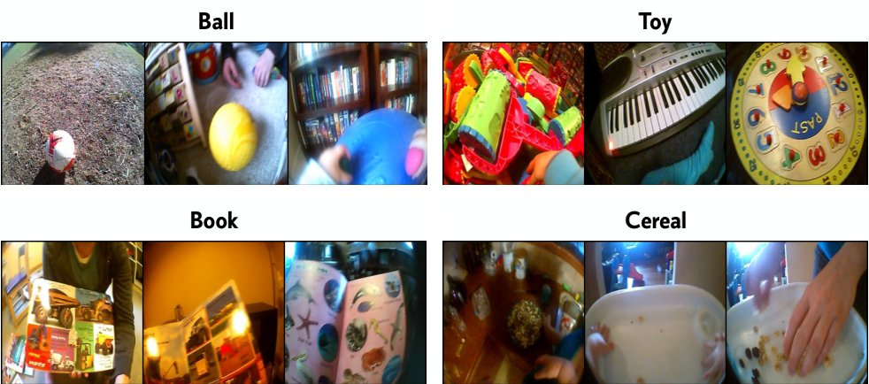
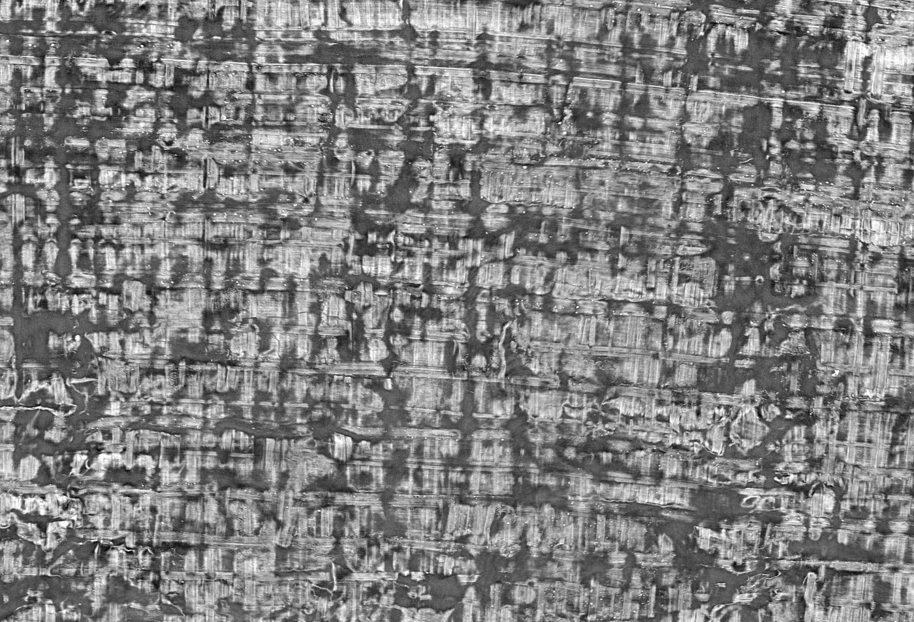
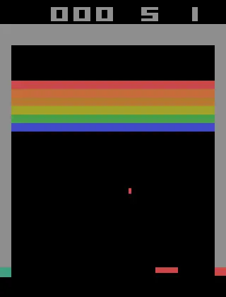
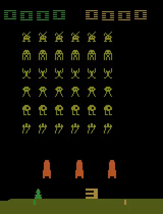
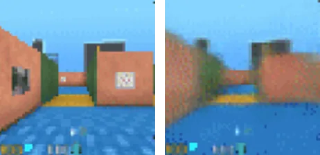
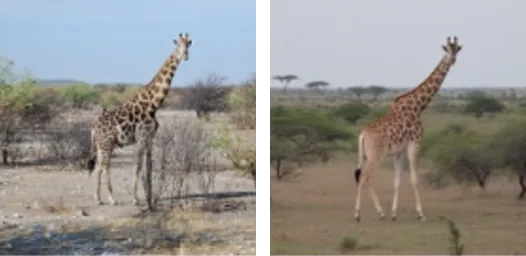

<link rel="stylesheet" href="/course/assets/course.css">

In the late 1980s, Mriganka Sur's lab at MIT did something that sounds like a bit of a mean prank on the brain. In newborn ferrets, they rerouted the nerves coming from the eyes into the auditory pathway, so that the auditory cortex, the part of the brain that normally deals with sound, was fed light instead. Now when these ferrets grew up, their auditory cortex had learned to "see". Its neurons became [tuned to the orientation and direction of moving edges](https://doi.org/10.1523/jneurosci.12-09-03651.1992), just like neurons in visual cortex, and they [organized themselves into the same kind of orientation maps](https://doi.org/10.1038/35009043). The ferrets even [treated light seen only by the rewired cortex as light rather than sound](https://doi.org/10.1038/35009102). Around the same time, [the same trick worked in hamsters](https://doi.org/10.1073/pnas.86.1.357), whose touch cortex learned to see instead. Humans do it without any surgery. In people blind from an early age, [the visual cortex becomes active when they read Braille](https://doi.org/10.1038/380526a0), and [briefly disrupting it with magnetic stimulation](https://doi.org/10.1038/38278) makes them misread the letters and distorts what they feel under their fingers.

So what does this mean? Apparently neurons/networks have some flexibility which wouldn't be a shocker by any means. But let's consider a stronger perspective on it. So if your neurons or any other type of information processing system is defined chiefly by the data it gets then there really could be a *universal learning algorithm* right?

I think you see where this is going. In our faithful search for *the* algorithm we were able to find an approximation for it or as Sam Altman himself says ["In three words: deep learning worked."](https://ia.samaltman.com/) Now i hope you liked that hook because the rest of this is for sure not going to be similarly dramatic or exciting because this is actually a course. It's going to be focused on getting you from no background knowledge to (ideally) a place where you have strong foundations and are able to formulate research ideas intuitively. It will be a bit more RL-heavy, and we will go over the foundations it needs piece by piece, before branching into (Multi-Agent) RL, continual learning, world models, NeuroAI and some other niches. My hope is that you come out with both strong foundations and an interesting specialization. Now since this is a <em class="party">course</em> as custom dictates, i'll show you some examples on how DL has been used.

## A short tour

Now obviously you have the classic examples, like self-driving cars, phones that unlock when they see your face, translation apps, and the chatbot you ask to explain papers to you. But you can do some other stuff with it too. For example, you can put a camera on a baby's head, record what they see and hear from 6 to 25 months of age, and ask whether a generic neural network can [learn words from that footage alone](https://doi.org/10.1126/science.adi1374).

<figure class="anim-wide anim-pair">
  
  <figcaption>What the child's headcam saw, grouped by what is in view · adapted from <a href="https://arxiv.org/abs/2507.14749">Vong &amp; Lake, 2025</a>, CC BY 4.0</figcaption>
</figure>

You can even run social experiments. Let an RL agent [decide who is connected to whom in a cooperation game](https://doi.org/10.1038/s41562-023-01686-7), have one [design how a group shares its money](https://doi.org/10.1038/s41562-022-01383-x), use a language model to [mediate between people who disagree](https://doi.org/10.1126/science.adq2852), and track [how rats behave around each other when the lights go out](https://doi.org/10.1371/journal.pone.0307794).

You can use it on languages nobody speaks anymore, to [read scrolls carbonized by Vesuvius](https://scrollprize.org/) and to [translate Akkadian cuneiform tablets into English](https://www.kaggle.com/competitions/deep-past-initiative-machine-translation).

<figure class="compare-fig">
  

    
    
    
    <input type="range" min="0" max="100" value="50" aria-label="Move the split between the scan and the detected ink">
  

  <figcaption>A patch of a carbonized scroll as the X-ray scan sees it (left) and the ink a model found in it (right) · <a href="https://scrollprize.org/">Vesuvius Challenge</a>, CC BY-NC 4.0</figcaption>
</figure>

You can build agents that [imagine how the world will turn out before they act](https://doi.org/10.1038/s41586-025-08744-2), that [play games](https://doi.org/10.1038/nature14236) from nothing but the screen and the score, and that [learn to work alongside humans](https://arxiv.org/abs/1910.05789) instead of only with copies of themselves.

  <figure>
    
    <figcaption>DQN playing Breakout</figcaption>
  </figure>
  <figure>
    
    <figcaption>DQN playing Space Invaders</figcaption>
  </figure>

<figure class="anim-wide anim-pair">
  
  <figcaption>What really happened (left) and what Dreamer imagined from the first few frames and the actions (right) · adapted from <a href="https://doi.org/10.1038/s41586-025-08744-2">Hafner et al., 2025</a>, CC BY 4.0</figcaption>
</figure>

And you can turn it back on the brain itself. You can use it to reconstruct [the images someone is looking at](https://arxiv.org/abs/2510.25976), to [describe in words what they are watching or remembering](https://doi.org/10.1126/sciadv.adw1464), to pick up [sentences they only say in their heads](https://doi.org/10.1016/j.cell.2025.06.015), and even to decode [what they see in their dreams](https://doi.org/10.3389/fncom.2017.00004).

<figure class="anim-wide anim-pair">
  
  <figcaption>A photo someone saw (left) and the image rebuilt from their brain activity (right) · adapted from <a href="https://arxiv.org/abs/2510.25976">Beliy et al., 2025</a>, CC BY-NC-SA 4.0</figcaption>
</figure>

It can let you ask questions about information itself too. Consider Plato's Cave (yes, i know). The prisoners only ever see shadows on the wall, never the things casting them. Well images and text are basically two different sets of shadows of the same world, so you can ask whether vision and language models, each stuck with its own shadows, end up [recovering the same world behind them](https://arxiv.org/abs/2405.07987). You can even try to [translate between models without a single matched example](https://arxiv.org/abs/2505.12540), and argue over [how far that agreement really goes](https://arxiv.org/abs/2602.14486). Jakob von Uexküll would push back on that though. He thought every animal lives in its own little world, its *Umwelt*, carved out by what it senses and needs, and agents like [MuZero](https://doi.org/10.1038/s41586-020-03051-4) do something similar, planning with a model of only the parts of the world that [matter for their decisions](https://arxiv.org/abs/2011.03506). So does every learner end up with the same picture, or only the ones that have to do everything? With deep learning we can sink our teeth into that question.

<figure class="concept">

<svg viewBox="0 0 360 290" role="img" aria-label="A vision model and a language model place the same things in rotated maps that line up">
<text class="title" x="180" y="26">Plato</text>
<g class="legend"><circle cx="128" cy="47" r="5" class="dot-a"/><text x="138" y="51">vision</text>
<circle cx="196" cy="47" r="5" class="dot-b"/><text x="206" y="51">text</text></g>
<g transform="translate(180,160)">
<g transform="translate(-56,-38)"><circle r="6" class="dot-a"/><text x="10" y="4">dog</text></g>
<g transform="translate(-35,-57)"><circle r="6" class="dot-a"/><text x="10" y="4">cat</text></g>
<g transform="translate(-77,13)"><circle r="6" class="dot-a"/><text x="10" y="4">person</text></g>
<g transform="translate(20,-76)"><circle r="6" class="dot-a"/><text x="10" y="4">apple</text></g>
<g transform="translate(84,-58)"><circle r="6" class="dot-a"/><text x="10" y="4">banana</text></g>
<g transform="translate(37,20)"><circle r="6" class="dot-a"/><text x="10" y="4">car</text></g>
<g transform="translate(84,102)"><circle r="6" class="dot-a"/><text x="10" y="4">bus</text></g>
<g><animateMotion path="M-38.0,56.0 A67.7,67.7 0 0 1 -56,-38" keyPoints="0;0;1;1;0" dur="9s" repeatCount="indefinite" calcMode="spline" keyTimes="0;0.15;0.5;0.85;1" keySplines="0 0 1 1;.4 0 .2 1;0 0 1 1;.4 0 .2 1"/><circle r="6" class="dot-b"/><text x="10" y="4" class="label-b">dog<animate attributeName="opacity" values="1;1;0;0;1;1" dur="9s" repeatCount="indefinite" keyTimes="0;0.4;0.5;0.85;0.9;1"/></text></g>
<g><animateMotion path="M-57.0,35.0 A66.9,66.9 0 0 1 -35,-57" keyPoints="0;0;1;1;0" dur="9s" repeatCount="indefinite" calcMode="spline" keyTimes="0;0.15;0.5;0.85;1" keySplines="0 0 1 1;.4 0 .2 1;0 0 1 1;.4 0 .2 1"/><circle r="6" class="dot-b"/><text x="10" y="4" class="label-b">cat<animate attributeName="opacity" values="1;1;0;0;1;1" dur="9s" repeatCount="indefinite" keyTimes="0;0.4;0.5;0.85;0.9;1"/></text></g>
<g><animateMotion path="M13.0,77.0 A78.1,78.1 0 0 1 -77,13" keyPoints="0;0;1;1;0" dur="9s" repeatCount="indefinite" calcMode="spline" keyTimes="0;0.15;0.5;0.85;1" keySplines="0 0 1 1;.4 0 .2 1;0 0 1 1;.4 0 .2 1"/><circle r="6" class="dot-b"/><text x="10" y="4" class="label-b">person<animate attributeName="opacity" values="1;1;0;0;1;1" dur="9s" repeatCount="indefinite" keyTimes="0;0.4;0.5;0.85;0.9;1"/></text></g>
<g><animateMotion path="M-76.0,-20.0 A78.6,78.6 0 0 1 20,-76" keyPoints="0;0;1;1;0" dur="9s" repeatCount="indefinite" calcMode="spline" keyTimes="0;0.15;0.5;0.85;1" keySplines="0 0 1 1;.4 0 .2 1;0 0 1 1;.4 0 .2 1"/><circle r="6" class="dot-b"/><text x="10" y="4" class="label-b">apple<animate attributeName="opacity" values="1;1;0;0;1;1" dur="9s" repeatCount="indefinite" keyTimes="0;0.4;0.5;0.85;0.9;1"/></text></g>
<g><animateMotion path="M-58.0,-84.0 A102.1,102.1 0 0 1 84,-58" keyPoints="0;0;1;1;0" dur="9s" repeatCount="indefinite" calcMode="spline" keyTimes="0;0.15;0.5;0.85;1" keySplines="0 0 1 1;.4 0 .2 1;0 0 1 1;.4 0 .2 1"/><circle r="6" class="dot-b"/><text x="10" y="4" class="label-b">banana<animate attributeName="opacity" values="1;1;0;0;1;1" dur="9s" repeatCount="indefinite" keyTimes="0;0.4;0.5;0.85;0.9;1"/></text></g>
<g><animateMotion path="M20.0,-37.0 A42.1,42.1 0 0 1 37,20" keyPoints="0;0;1;1;0" dur="9s" repeatCount="indefinite" calcMode="spline" keyTimes="0;0.15;0.5;0.85;1" keySplines="0 0 1 1;.4 0 .2 1;0 0 1 1;.4 0 .2 1"/><circle r="6" class="dot-b"/><text x="10" y="4" class="label-b">car<animate attributeName="opacity" values="1;1;0;0;1;1" dur="9s" repeatCount="indefinite" keyTimes="0;0.4;0.5;0.85;0.9;1"/></text></g>
<g><animateMotion path="M102.0,-84.0 A132.1,132.1 0 0 1 84,102" keyPoints="0;0;1;1;0" dur="9s" repeatCount="indefinite" calcMode="spline" keyTimes="0;0.15;0.5;0.85;1" keySplines="0 0 1 1;.4 0 .2 1;0 0 1 1;.4 0 .2 1"/><circle r="6" class="dot-b"/><text x="10" y="4" class="label-b">bus<animate attributeName="opacity" values="1;1;0;0;1;1" dur="9s" repeatCount="indefinite" keyTimes="0;0.4;0.5;0.85;0.9;1"/></text></g>
</g></svg>
<svg viewBox="0 0 360 290" role="img" aria-label="The same things, sorted by a tick into warm and not warm">
<text class="title" x="180" y="26">Umwelt</text>
<g class="pile" opacity="0"><animate attributeName="opacity" values="0;0;1;1;0;0" dur="9s" repeatCount="indefinite" keyTimes="0;0.4;0.5;0.85;0.9;1"/>
<rect x="34" y="78" width="122" height="160" rx="10"/><text x="95" y="262">warm</text>
<rect x="194" y="78" width="132" height="160" rx="10"/><text x="260" y="262">not warm</text></g>
<g><animateTransform attributeName="transform" type="translate" values="124 122;124 122;60 125;60 125;124 122" dur="9s" repeatCount="indefinite" calcMode="spline" keyTimes="0;0.15;0.5;0.85;1" keySplines="0 0 1 1;.4 0 .2 1;0 0 1 1;.4 0 .2 1"/><circle r="6" class="dot-c"/><text x="10" y="4">dog</text></g>
<g><animateTransform attributeName="transform" type="translate" values="145 103;145 103;60 160;60 160;145 103" dur="9s" repeatCount="indefinite" calcMode="spline" keyTimes="0;0.15;0.5;0.85;1" keySplines="0 0 1 1;.4 0 .2 1;0 0 1 1;.4 0 .2 1"/><circle r="6" class="dot-c"/><text x="10" y="4">cat</text></g>
<g><animateTransform attributeName="transform" type="translate" values="103 173;103 173;60 195;60 195;103 173" dur="9s" repeatCount="indefinite" calcMode="spline" keyTimes="0;0.15;0.5;0.85;1" keySplines="0 0 1 1;.4 0 .2 1;0 0 1 1;.4 0 .2 1"/><circle r="6" class="dot-c"/><text x="10" y="4">person</text></g>
<g><animateTransform attributeName="transform" type="translate" values="200 84;200 84;220 108;220 108;200 84" dur="9s" repeatCount="indefinite" calcMode="spline" keyTimes="0;0.15;0.5;0.85;1" keySplines="0 0 1 1;.4 0 .2 1;0 0 1 1;.4 0 .2 1"/><circle r="6" class="dot-c"/><text x="10" y="4">apple</text></g>
<g><animateTransform attributeName="transform" type="translate" values="264 102;264 102;220 143;220 143;264 102" dur="9s" repeatCount="indefinite" calcMode="spline" keyTimes="0;0.15;0.5;0.85;1" keySplines="0 0 1 1;.4 0 .2 1;0 0 1 1;.4 0 .2 1"/><circle r="6" class="dot-c"/><text x="10" y="4">banana</text></g>
<g><animateTransform attributeName="transform" type="translate" values="217 180;217 180;220 178;220 178;217 180" dur="9s" repeatCount="indefinite" calcMode="spline" keyTimes="0;0.15;0.5;0.85;1" keySplines="0 0 1 1;.4 0 .2 1;0 0 1 1;.4 0 .2 1"/><circle r="6" class="dot-c"/><text x="10" y="4">car</text></g>
<g><animateTransform attributeName="transform" type="translate" values="264 262;264 262;220 213;220 213;264 262" dur="9s" repeatCount="indefinite" calcMode="spline" keyTimes="0;0.15;0.5;0.85;1" keySplines="0 0 1 1;.4 0 .2 1;0 0 1 1;.4 0 .2 1"/><circle r="6" class="dot-c"/><text x="10" y="4">bus</text></g>
</svg>

<figcaption>Plato, a vision model and a language model whose maps of the same things differ only by a turn. Umwelt, the same things as a tick sorts them.</figcaption>
</figure>

## The structure

Now the motivation of this course is obviously a bit skewed. It will lean heavily on the stuff I think is foundational, and on what I'm currently reading about and working on. But to give it more structure, I'm going to borrow from educational resources that I very much enjoyed myself. For the basics we will go with [An Introduction to Statistical Learning](https://www.statlearning.com/). For deep learning fundamentals we're going to borrow a lot from [Understanding Deep Learning](https://udlbook.github.io/udlbook/), [Introduction to Deep Learning](https://introtodeeplearning.com/) and Stanford's [CS230](https://cs230.stanford.edu/). Reinforcement learning will take up a significant portion of our time, and for it we will rely on Stanford's [CS224R](https://cs224r.stanford.edu/), [Mathematical Foundations of Reinforcement Learning](https://github.com/MathFoundationRL/Book-Mathematical-Foundation-of-Reinforcement-Learning) and Sutton and Barto's [Reinforcement Learning](http://incompleteideas.net/book/the-book-2nd.html). For our robotics branch we will use MIT's [Robotic Manipulation](https://manipulation.csail.mit.edu/) and Hugging Face's [Robot Learning tutorial](https://huggingface.co/spaces/lerobot/robot-learning-tutorial), plus their [robotics course](https://huggingface.co/learn/robotics-course) for some more hands-on stuff. For a general perspective and intuition we will borrow ideas from [Deep Learning Alchemy](https://deep-learning-alchemy.github.io/) and [Introduction to Deep Learning Research](https://atcold.github.io/NYU-DLFL25U), and some of our exercises will come straight from [Deep-ML](https://www.deep-ml.com/).

There is a lot of overlap between these, and even I haven't gone through all of them in full, but they are all good places to look if you want extra material. What I'm trying to do here is find a good balance between theory, conceptual intuition and rigor in both math and code. Some of these resources strike that balance and some don't, so you're more than welcome to dig into them on your own, but be warned that their focus and approachability might not quite be what you're after.

We will try to focus on what a method is conceptually and intuitively, how it is applied in math and code, and how it is used historically and practically. Ideally this chain will be obvious for everything we discuss, and I'll try to lean on the fact that this is an online, interactive course to strengthen our hand here. Now as a final disclaimer, I'm not an expert in any of these fields. I think I have been through them enough times to be at least reasonably knowledgeable, but if you want to hear from bona fide experts, the materials mentioned above are, I believe, high quality.

